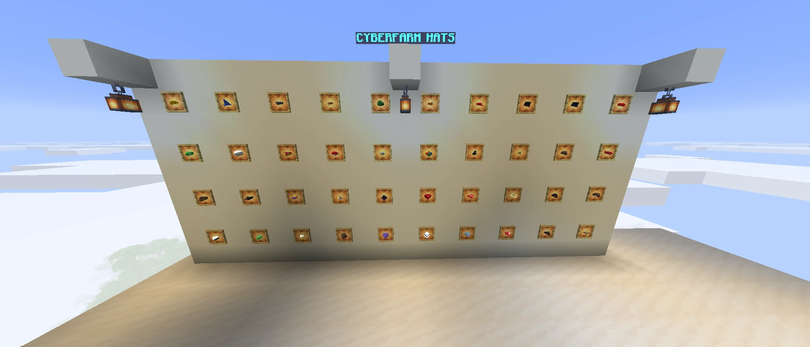
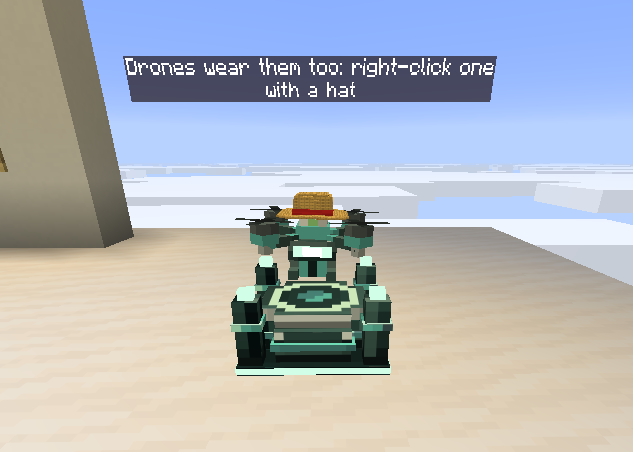

# CyberFarm Hats

A cosmetic addon for [CyberFarm](https://github.com/Gianni1707/cyberfarm): hats that you and your drones can wear.

- **Wear one:** right-click with it, or put it in the helmet slot.
- **On a drone:** right-click the drone with the hat (sneak on a Taxi drone). Shears take it off.
- A picked-up or destroyed drone drops its hat.





## Build

One branch per Minecraft version, like CyberFarm: `master` for 26.2, `mc/26.1.2` and `mc/1.20.1`. Each builds
against the CyberFarm release named by `cyberfarm_version` in `gradle.properties`, downloaded from its GitHub
releases. To build against a CyberFarm not released yet, put its jar in a folder as `v<version>/cyberfarm-<version>.jar`
and add `-Pcyberfarm_repo=file:///that/folder/` to every command.

```
./gradlew build                # build/libs/cyberhats-<version>.jar
./gradlew runClient            # dev client with CyberFarm, the addon, GuideME and JEI (-Pworld="New World" opens that world)
./gradlew runGameTestServer    # checks that a drone can wear a hat and drops it when picked up
```

## Adding a hat

1. Its name in `CyberHats.HATS`.
2. Its boxes, materials, drawings, title and recipe in `tools/hats.py`, then `python tools/hats.py`: it writes the
   model, the texture, the item file, the recipe, the name and the handbook page. Never edit those by hand.

The rules a hat's shape must follow are at the top of `tools/hats.py`. On a drone the hat stands on the tank and
the antenna is hidden: that needs the `antenna` part in CyberFarm's `DroneModel` (on an older CyberFarm the hat
still shows, with the antenna through it).
