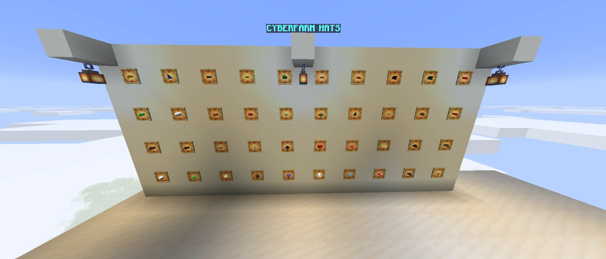
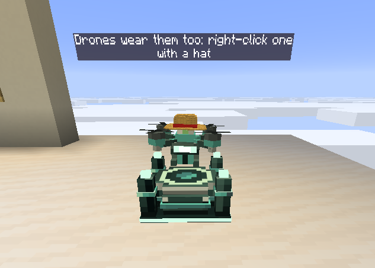

# CyberFarm Hats

A cosmetic addon for [CyberFarm](https://github.com/Gianni1707/cyberfarm): forty-eight hats that you, your armor
stands and your drones can wear. They do nothing at all, and look good doing it.





## Wearing a hat

- **Right-click** with it, or put it in the **helmet slot**.
- **Over a helmet:** put it in the **Hat slot**, right of you in the inventory, above the offhand. It shows on your
  head in place of the helmet, which still protects you; the **eye** above the slot hides it for a while.
- **On a drone:** right-click the drone with the hat (sneaking, on a Taxi drone, on 26.x). The drone folds its antenna
  away and wears the hat on its tank. Shears take it off; a picked-up or destroyed drone drops its hat.
- Hats come down over the head like a real beanie; a halo or a chicken sits on top.
- **Some hats move:** the propeller spins, tassels and floppy tips sway, the jester's points jiggle, the halo floats and
  turns, the frog blinks, the chicken pecks. On a head, on a drone, in a frame or in a slot alike.
- Hats from games, anime and films show a famous line from them under their name.

## Other mods

- **Curios** (every version): there is no Hat slot; hats go in Curios' head slot instead, and still show in place of
  the helmet.
- **Cosmetic Armor Reworked** (1.20.1): there is no Hat slot; hats go in its cosmetic head slot.
- **JEI** (optional): an information page on every hat.
- The handbook (GuideME on 26.x, Patchouli on 1.20.1) has a **Hats** page with every hat and its recipe.

## Versions

| Minecraft | Loader | Branch | Needs |
| --- | --- | --- | --- |
| 26.2 | NeoForge 26.2.0.93+ | `master` | CyberFarm 1.0.0+ |
| 26.1.2 | NeoForge 26.1.2.97+ | `mc/26.1.2` | CyberFarm 1.0.0+ |
| 1.20.1 | Forge 47.1.3+ | `mc/1.20.1` | CyberFarm 1.0.0+ |

Download from the [releases](https://github.com/Gianni1707/cyberfarm-hats/releases).

## Build

Each branch builds against the CyberFarm release named by `cyberfarm_version` in `gradle.properties`, downloaded
from its GitHub releases. To build against a CyberFarm not released yet, put its jar in a folder as
`v<version>/cyberfarm-<version>.jar` and add `-Pcyberfarm_repo=file:///that/folder/` to every command.

```
./gradlew build                # build/libs/cyberhats-<version>.jar
./gradlew runClient            # dev client with CyberFarm, the addon, the handbook and JEI (-Pworld="New World" opens that world)
./gradlew runClient -Pcurios   # the same, with Curios
./gradlew runGameTestServer    # checks the Hat slot, and that a drone wears a hat and drops it when picked up
```

## Adding a hat

1. Its name in `CyberHats.HATS` (and in `CyberHats.QUOTED` if it has a famous line).
2. Its boxes, materials, drawings, moving parts, title, quote and recipe in `tools/hats.py`, then
   `python tools/hats.py`: it writes the model, the texture, the item file, the moving parts, the recipe, the names
   and the handbook page. Never edit those by hand. The script is the same on every branch and writes each
   version's formats.

The rules a hat's shape must follow are at the top of `tools/hats.py`; the script checks them, moving parts included.
On a drone the hat stands on the tank and the antenna is hidden: that needs the `antenna` part in CyberFarm's
`DroneModel` (CyberFarm 1.0.0 or newer).
